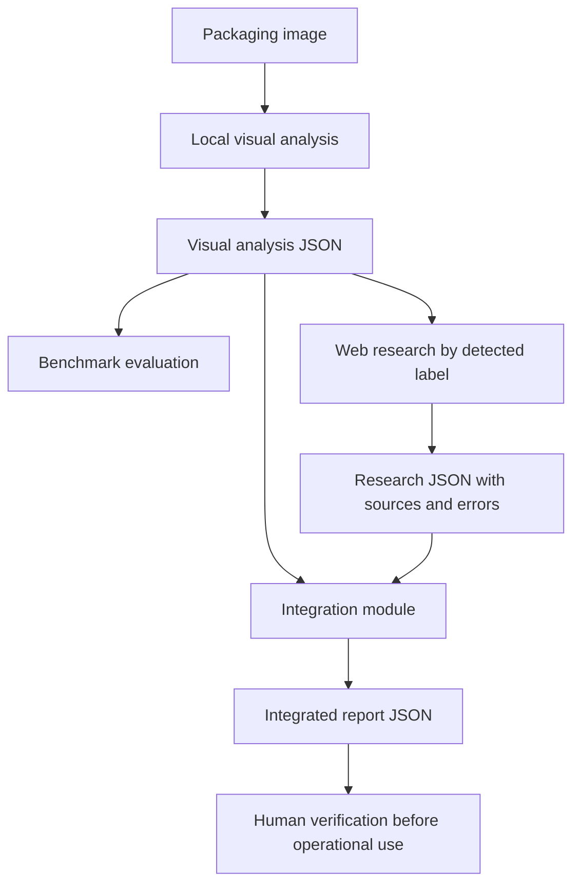

# AI Agent Training — From Foundations to Logistics Applications

## Overview
This repository documents my hands-on journey into Artificial Intelligence, Large Language Models (LLMs), and AI agent development.

Building upon my Computer Science Foundations training at Holberton School and my current studies in Industrial Engineering, my objective is to explore how AI technologies can improve logistics, supply chain management, and operational decision-making.

This repository combines structured learning, independent programming exercises, technical documentation, and practical projects.

## Learning Objectives
- Understand the fundamentals of AI agents and LLMs.
- Develop Python applications that interact with language models.
- Experiment with local AI models using Ollama.
- Learn AI agent frameworks, including Hugging Face smolagents.
- Explore practical applications in logistics and industrial engineering.
- Build a documented technical portfolio through GitHub.

## Technologies
- Python
- Ollama
- Qwen2:1.5b
- Hugging Face
- smolagents
- Git and GitHub
- Windows PowerShell
Additional technologies will be documented as they are introduced.

## Repository Structure

```text
AI-Agent-Training/
├── data/
│   └── exercise_009/
│       ├── damaged_shipment_policy.txt
│       ├── delayed_delivery_policy.txt
│       └── shipment_escalation_policy.txt
│   └── exercise_010/
│       └── shipments.json
├── exercises/
│   ├── first_local_llm.py
│   ├── logistics_dummy_agent.py
│   ├── structured_logistics_agent.py
│   ├── smolagents_logistics_agent.py
│   ├── logistics_exception_agent.py
│   ├── logistics_knowledge_agent.py
│   ├── logistics_policy_decision_agent.py
│   ├── multimodal_logistics_agent.py
│   ├── logistics_web_search.py
│   ├── exercise_008_integrator.py
│   ├── exercise_008_evaluator.py
│   ├── exercise_008_ground_truth.json
│   ├── exercise_008_generic_ground_truth.json
│   ├── logistics_semantic_search_agent.py
│   ├── logistics_tool_using_rag_agent.py
│   ├── logistics_rag_llm_agent.py
│   ├── logistics_langgraph_workflow.py
│   ├── logistics_multi_agent_system.py
│   ├── exercise_012_tests.py
│   ├── shipment_exception_routing.py
│   ├── exercise_013_tests.py
│   └── logistics_research_agent.py
├── projects/
│   └── logistics_research/
│       ├── data/
│       │   └── shipments.json
│       ├── tests/
│       │   ├── test_shipment_analysis.py
│       │   ├── test_research_tools.py
│       │   ├── test_external_research.py
│       │   ├── test_research_workflow.py
│       │   └── test_evidence_quality.py
│       ├── shipment_analysis.py
│       ├── research_tools.py
│       ├── external_research.py
│       ├── research_workflow.py
│       └── evidence_quality.py
├── notes/
│   ├── exercise_001.md
│   ├── exercise_002.md
│   ├── exercise_003.md
│   ├── exercise_004.md
│   ├── exercise_005.md
│   ├── exercise_006.md
│   ├── exercise_007.md
│   ├── exercise_008.md
│   ├── exercise_009.md
│   ├── exercise_010.md
│   ├── exercise_011.md
│   ├── exercise_012.md
│   ├── exercise_013.md
│   └── exercise_014.md
├── results/
│   └── exercise_008/          # Local generated test outputs
├── archive/                   # Local experimental history
├── storage/
│   └── exercise_009/          # Local persistent vector index
├── projects/
├── README.md
└── .gitignore
```

## Training Progress
| Exercise | Description | Status |
|---|---|---|
| 001 | Running My First Local LLM | Completed |
| 002 | Logistics Dummy Agent - Thought-Action-Observation Cycle | Completed |
| 003 | Structured Logistics Agent - JSON Tool Calling | Completed |
| 004 | Smolagents Logistics Agent - Framework-Based Tool Calling | Completed |
| 005 | Logistics Exception Management Agent | Completed |
| 006 | Logistics Knowledge Retrieval Agent - Policy Search and Tool Calling | Completed |
| 007 | Logistics Policy Decision Agent | Completed |
| 008 | Multimodal Logistics Research Agent | Completed prototype — human verification required |
| 009 | Logistics Semantic Search Agent — LlamaIndex | Completed |
| 010 | Logistics Tool-Using RAG Agent - Shipment Retrieval, Semantic Policy Search, and Validated Reporting | Completed Prototype - LLM Tool-Calling Limitations Documented |
| 011 | Reliable Logistics Workflows with LangGraph — State Management, Conditional Routing, Semantic Policy Retrieval, and Human-Reviewed Decision Support | Completed |
| 012 | Multi-Agent Freight Operations System — Five Specialized Agents, LangGraph Orchestration, Semantic Policy Retrieval, Exception Analysis, Human Review Controls, and Automated Integration Testing | Completed — 3/3 Tests Passed |
| 013 | Shipment Exception Routing with LangGraph | Completed |
| 014 | Logistics Research & Decision Support Agent — Shipment Analysis, External Research, Evidence Quality Assessment, and Automated Testing | Completed — 36/36 Tests Passed |


## Exercise 001 — Running My First Local LLM
**Date:** October 25, 2026
For my first exercise, I configured a local language model using Ollama and Python.

I successfully executed Qwen2:1.5b and developed a Python script that communicated with the local model.

The application explored how AI technologies could support logistics operations, including route optimization, inventory management, and supply chain visibility.

**Source code:** [first_local_llm.py](exercises/first_local_llm.py)

**Technical documentation:** [Exercise 001](notes/exercise_001.md)

## Exercise 002 — Logistics Dummy Agent
**Date:** October 2026

### Objective
Develop a basic logistics AI agent that demonstrates the Thought–Action–Observation cycle using a locally running language model and a Python shipment-tracking tool.

### Technologies
- Python 3.12
- Ollama
- LiteLLM
- Smolagents
- Qwen2 1.5B
- Requests
- Windows PowerShell

### Implementation
In this exercise, I developed a Python script that simulates the behavior of an AI agent.

The agent receives a shipment-related question, uses the local language model to identify the shipment ID, retrieves the shipment's status from a simulated database, and generates an explanation based on the verified information.

The workflow follows three stages:
1. **Thought:** The language model interprets the user's question and identifies the shipment.
2. **Action:** A Python function retrieves the corresponding tracking status.
3. **Observation:** The verified result is provided to the model to generate the final response.

### Testing Results
| Shipment | Expected Result | Result |
|---|---|---|
| SHP-001 | In Transit | Passed |
| SHP-002 | Delivered | Passed |
| SHP-004 | Delayed | Passed |
| SHP-999 | Shipment not found | Passed |

### Challenges and Lessons Learned
One important challenge was preventing the language model from inventing information when a shipment did not exist.

To address this, I implemented deterministic handling for missing shipments. Instead of allowing the language model to generate an unsupported response, the program returns a predefined message asking the user to verify the shipment ID.

This exercise helped me understand the relationship between language-model reasoning, Python tools, verified observations, and reliable final responses.

**Source Code:** [logistics_dummy_agent.py](exercises/logistics_dummy_agent.py)

**Documentation:** [exercise_002.md](notes/exercise_002.md)

---

## Exercise 003 — Structured Logistics Agent
**Date:** October 26, 2026

### Objective
Develop a logistics AI agent that uses structured JSON output to request tool execution rather than relying exclusively on unstructured natural-language responses.

### Technologies
- Python 3.12
- Ollama
- Qwen2 1.5B
- Requests
- JSON
- Windows PowerShell

### Implementation
In this exercise, I expanded the previous logistics agent by introducing structured action requests.

The language model receives a shipment-related question and generates a JSON object specifying the action to perform and the required arguments.

Example:

```json
{
"action": "get_shipment_status",
"action_input": {
"shipment_id": "SHP-004"
}
}
```

The Python application parses this JSON, identifies the requested tool, executes the shipment-tracking function, and retrieves the verified observation.

The result is then used to produce a final response.

### Testing Results
| Shipment | Expected Result | Result |
|---|---|---|
| SHP-001 | In Transit | Passed |
| SHP-002 | Delivered | Passed |
| SHP-004 | Delayed | Passed |
| SHP-999 | Shipment not found | Passed |

### Challenges and Lessons Learned
This exercise demonstrated how structured outputs make interactions between language models and software tools more predictable.

I also reinforced the importance of validating shipment information before generating a final answer, particularly when a shipment ID does not exist in the simulated database.

The main improvement over Exercise 002 was the introduction of machine-readable JSON action requests, creating a clearer separation between the language model's decisions and Python's tool execution.

**Source Code:** [structured_logistics_agent.py](exercises/structured_logistics_agent.py)

**Documentation:** [exercise_003.md](notes/exercise_003.md)

---

## Exercise 004 — Smolagents Logistics Agent
**Date:** October 26, 2026

### Objective
Implement a logistics AI agent using the Hugging Face Smolagents framework, moving from manually managed tool execution to framework-based tool calling.

### Technologies
- Python 3.12
- Hugging Face Smolagents
- LiteLLM
- Ollama
- Qwen2 1.5B
- Windows PowerShell

### Implementation
In this exercise, I implemented a logistics agent using `ToolCallingAgent` and `LiteLLMModel`.

The agent connects to the locally running Qwen2 1.5B model through Ollama and uses registered Python tools to retrieve shipment information.

Two tools were implemented:
1. **get_shipment_status:** Retrieves the verified tracking status for a shipment ID.
2. **list_delayed_shipments:** Returns the shipment IDs currently marked as delayed.

Unlike the previous exercises, the framework manages the interaction between the language model and its registered tools.

### Testing Results
| Test | Expected Result | Result |
|---|---|---|
| SHP-004 | Delayed | Passed |
| SHP-999 | Shipment not found | Passed |
| List delayed shipments | SHP-004 | Passed |

### Challenges and Lessons Learned
During development, I encountered several technical challenges, including dependency installation, restricted code execution, unauthorized imports, and model compatibility.

Initially, I experimented with `CodeAgent`, but the smaller local model generated Python code that was incompatible with the framework's execution restrictions.

I resolved this by switching to `ToolCallingAgent`, allowing the model to invoke explicitly registered Python tools instead of generating unrestricted Python code.

I also installed additional dependencies required for successful tool execution.

This exercise helped me understand the differences between manually implemented agents and framework-based agents, while reinforcing the importance of controlled tool execution and verified logistics information.

**Source Code:** [smolagents_logistics_agent.py](exercises/smolagents_logistics_agent.py)

**Documentation:** [exercise_004.md](notes/exercise_004.md)

## Exercise 005 — Logistics Exception Management Agent
**Course:** Hugging Face AI Agents Course — Unit 2.1: smolagents

**Date:** October 28, 2026

### Objective
Extend the shipment-tracking capabilities developed in Exercise 004 into a logistics exception management agent capable of identifying delivery delays, classifying operational priorities, and recommending appropriate actions.

### What I Built
I developed a Python-based logistics exception management system that combines deterministic business rules with AI-powered tool calling.

The system can:
- Retrieve shipment information from a simulated database.
- Calculate delivery delays using a fixed reference date.
- Classify exceptions as NONE, LOW, MEDIUM, or HIGH.
- Recommend operational actions based on predefined rules.
- Generate structured JSON exception reports.
- Execute a custom tool through the smolagents framework.
- Interpret natural-language requests using a locally hosted AI model.
- Handle unknown shipment IDs without inventing tracking information.

### Technologies Used
- Python 3.12.4
- smolagents 1.26.0
- Ollama
- Qwen2 1.5B
- LiteLLMModel
- ToolCallingAgent
- JSON

### Testing Results
| Shipment | Delay | Priority | Recommended Action |
|----------|-------|----------|--------------------|
| SHP-001 | 0 days | NONE | No action required |
| SHP-002 | 0 days | NONE | No action required |
| SHP-003 | 2 days | LOW | Monitor shipment |
| SHP-004 | 5 days | HIGH | Escalate to logistics manager |
| SHP-005 | 4 days | MEDIUM | Contact carrier |
| SHP-999 | Not found | UNKNOWN | Verify shipment ID |
The Python business logic was tested across the priority categories.

The AI agent also successfully executed shipment analysis requests using the custom smolagents tool.

### What I Learned
This exercise helped me understand the importance of separating deterministic business logic from AI decision-making.

Instead of allowing the language model to calculate delays or invent operational recommendations, I created Python functions responsible for these tasks.

The AI agent focuses on interpreting requests, selecting the appropriate tool, and communicating the results.

This approach makes the system easier to test, maintain, and expand.

### Project Files
**Source Code:** [logistics_exception_agent.py](exercises/logistics_exception_agent.py)

**Technical Documentation:** [exercise_005.md](notes/exercise_005.md)

## Exercise 006 — Logistics Knowledge Retrieval Agent
**Course:** Hugging Face AI Agents Course — Unit 2.1: smolagents

**Date:** October 28, 2026

**Status:** Completed Prototype

### Objective
Develop a logistics knowledge retrieval agent capable of searching simulated company policies, identifying relevant operational procedures, and answering questions using retrieved information.

### What I Built
I developed a Python-based knowledge retrieval system combining a simulated logistics policy database, relevance-ranked search, and AI-powered tool calling through the smolagents framework.

The system can:
- Retrieve company policies using unique policy identifiers.
- Search operational procedures using keywords.
- Rank matching policies based on relevance scores.
- Retrieve procedures for delayed, damaged, and missing shipments.
- Provide customer notification guidance.
- Execute a custom knowledge retrieval tool through smolagents.
- Interpret natural-language questions using a locally hosted AI model.
- Generate answers based on retrieved company policies.
- Recognize when requested policies are unavailable.

### Technologies Used
- Python 3.12.4
- smolagents
- Ollama
- Qwen2 1.5B
- LiteLLMModel
- ToolCallingAgent
- JSON
- Git and GitHub

### Testing Results
| Test Scenario | Result |
|---|---|
| Direct policy retrieval | Passed |
| Keyword-based knowledge search | Passed |
| Relevance ranking | Passed |
| Damaged goods procedure | Passed |
| Delayed shipment procedure | Passed |
| Unknown insurance policy | Partially passed |
The agent successfully retrieved relevant logistics policies and provided procedural guidance.

During the insurance reimbursement test, the retrieval tool correctly reported that no relevant policy existed. However, the agent repeated its search and eventually produced a generic fallback response.

### Challenges and Lessons Learned
This exercise helped me understand how AI agents can retrieve organizational knowledge instead of relying entirely on a language model's internal knowledge.

I also learned that successful information retrieval does not guarantee an efficient or informative final response.

The main limitations involved search precision, repeated tool calls, and handling questions for which no policy was available.

These challenges reinforced the importance of grounding AI responses in verified information and evaluating retrieval quality separately from response generation.

**Source Code:** [logistics_knowledge_agent.py](exercises/logistics_knowledge_agent.py)

**Documentation:** [exercise_006.md](notes/exercise_006.md)

## Exercise 007 — Logistics Policy Decision Agent
**Course:** Hugging Face AI Agents Course — Unit 2.1: smolagents

**Date:** October 28, 2026

**Status:** Completed Prototype

### Objective
Develop a logistics decision-support system that integrates shipment exception analysis, company policy retrieval, and policy-based decision validation.

### What I Built
I developed a Python-based logistics policy decision agent that combines the capabilities of Exercises 005 and 006 into a more comprehensive operational workflow.

The system can:
- Analyze shipment status, delivery delays, and operational priorities.
- Retrieve relevant logistics policies from a simulated knowledge base.
- Match shipment exceptions with appropriate company procedures.
- Validate recommended actions against policy requirements.
- Generate structured decision reports.
- Handle missing or unknown shipment identifiers.
- Execute policy analysis through an AI agent using smolagents.
- Produce reliable, deterministic reports independently of the language model's final response.

### Technologies Used
- Python 3.12.4
- smolagents
- Ollama
- Qwen2 1.5B
- LiteLLMModel
- ToolCallingAgent
- JSON
- Git and GitHub

### Testing Results
| Test Scenario | Result |
|---|---|
| Shipment in transit — SHP-001 | Passed |
| Five-day shipment delay — SHP-004 | Passed |
| Unknown shipment — SHP-999 | Passed |
| Policy decision validation | Passed |
| Deterministic report generation | Passed |
| AI tool execution | Completed with observed model limitations |

### Key Learning Outcomes
This exercise demonstrated the importance of combining AI-powered reasoning with deterministic business logic.

During testing, I observed that a small local language model could successfully execute logistics tools but sometimes produce incomplete responses or repeat tool calls.

To address this limitation, I implemented a separate reliable reporting workflow that uses validated Python data rather than depending entirely on the model's generated text.

This approach provides a stronger foundation for developing dependable AI-assisted logistics applications.

**Source Code:** [logistics_policy_decision_agent.py](exercises/logistics_policy_decision_agent.py)

**Technical Documentation:** [exercise_007.md](notes/exercise_007.md)

## Exercise 008 — Multimodal Logistics Research Agent

**Date:** October 31 – November 1, 2026

**Status:** Completed prototype with known limitations

### Objective

Build a modular logistics research workflow that analyzes packaging images, evaluates detected handling symbols against reference labels, researches potential symbol meanings using public web search, and produces structured JSON reports for human review.

### What I Built

- **Visual analysis:** A local image-analysis workflow that records symbol labels, visual evidence, approximate locations, possible interpretations, and uncertainty.
- **Evaluation:** A benchmark that compares detected labels against a manually prepared reference set, reporting strict and alias-aware precision, recall, and F1 scores.
- **Web research:** An independent `ddgs`-based search module that saves titles, URLs, snippets, and search errors without presenting snippets as verified regulatory guidance.
- **Integration:** A Python module that links visual detections to web research records using normalized symbol labels and generates a combined JSON report.
- **Traceability:** Timestamped JSON outputs that preserve experimental results and make failures visible rather than silently replacing them.

### Workflow




### Testing Results

| Test | Observed result |
|---|---|
| Strict label matching | F1: 28.57% in the documented benchmark run |
| Alias-aware label matching | Precision: 62.50%; Recall: 83.33%; **F1: 71.43%** |
| Automatic research-to-visual matching | 8 of 8 detected symbol labels matched to research records in the latest shown run |
| Web search success | 4 of 8 searches returned results in that run; 4 reported search errors |
| Integrated JSON report | Generated successfully |

The 71.43% F1 score measures **alias-aware label matching on one test image**, not general-purpose visual accuracy. Matching all eight labels to research records confirms a working integration path; it does **not** mean eight symbols were correctly recognized or independently verified.

### Limitations and Lessons Learned

- The vision model may misidentify symbols, describe uncertain markings confidently, or confuse a generic marking with a standardized handling symbol.
- Label aliases improve matching but do not establish visual correctness.
- Search results can fail or contain unrelated, low-quality, or context-specific material; a search result is not an authoritative interpretation by itself.
- A packaging symbol's meaning may depend on the applicable standard, product, context, and accompanying markings.
- No instance-level symbol detection or regulatory compliance validation was demonstrated.
- Operational handling decisions require human verification and, where relevant, authoritative standards.

This exercise reinforced the importance of separating visual recognition, evaluation, external research, and deterministic report integration into independently testable components.

### Project Files

**Visual agent:** [multimodal_logistics_agent.py](exercises/multimodal_logistics_agent.py)

**Benchmark evaluator:** [exercise_008_evaluator.py](exercises/exercise_008_evaluator.py)

**Web research:** [logistics_web_search.py](exercises/logistics_web_search.py)

**Integration:** [exercise_008_integrator.py](exercises/exercise_008_integrator.py)

**Reference labels:** [exercise_008_ground_truth.json](exercises/exercise_008_ground_truth.json) and [exercise_008_generic_ground_truth.json](exercises/exercise_008_generic_ground_truth.json)

**Technical documentation:** [exercise_008.md](notes/exercise_008.md)

---

#### Exercise 009 — Logistics Semantic Search Agent

**Unit:** 2.2 — LlamaIndex  
**Status:** Completed  
**Focus:** Semantic Search, Vector Embeddings, Knowledge Retrieval, and Index Persistence

**Objective**

Develop a local semantic search system capable of retrieving relevant logistics policies from natural-language questions. The goal was to move beyond traditional keyword-based retrieval and introduce a vector-based knowledge retrieval architecture using LlamaIndex.

**Implementation**

The application was developed in Python using LlamaIndex and Hugging Face sentence embeddings. A small logistics knowledge base was created using three operational policies covering damaged shipments, delayed deliveries, and shipment exception escalation.

The system performs the following operations:

1. Loads logistics policy documents from local text files using `SimpleDirectoryReader`.
2. Converts the documents into numerical embeddings using the `BAAI/bge-small-en-v1.5` model.
3. Creates a semantic vector index using `VectorStoreIndex`.
4. Processes natural-language questions and retrieves the three most relevant policy documents.
5. Displays document names, similarity scores, and policy excerpts for inspection.
6. Saves the vector index locally and reloads it during subsequent executions to avoid unnecessary rebuilding.

**Validation and Results**

Three logistics scenarios were used to evaluate retrieval accuracy:

- **Damaged Shipment:** A customer reports receiving a broken package. The system correctly ranks the damaged shipment handling policy first, with a similarity score of 0.7081.
- **Delayed Delivery:** A shipment fails to arrive by its expected delivery date. The delayed delivery management policy is retrieved as the highest-ranked result, with a similarity score of 0.7481.
- **Operational Escalation:** A critical shipment exception requires supervisor review. The shipment exception escalation policy ranks first, with a similarity score of 0.8342.

All three tests successfully identified the expected policy as the highest-ranked document.

**Index Persistence**

An additional improvement was introduced to prevent the application from rebuilding the vector index every time it runs.

During the first execution, the system generates and saves the index under `storage/exercise_009/`. Subsequent executions load the previously stored index using LlamaIndex's storage context.

This demonstrates an important architectural concept: separating document indexing from repeated retrieval operations.

**Technical Limitations**

The current implementation uses a small, controlled knowledge base containing only three policies. The similarity scores represent semantic relevance rather than verified operational correctness.

The system currently retrieves supporting documents but does not generate complete, source-grounded operational recommendations. Additionally, the persisted index must be refreshed when the underlying policies are updated.

**Key Learning Outcomes**

This exercise introduced practical experience with semantic embeddings, vector similarity search, document retrieval, and persistent local indexes.

It also established the foundation for more advanced Retrieval-Augmented Generation (RAG) systems that can connect language models to documented operational knowledge.

**Technical Documentation:** [Exercise 009 — Logistics Semantic Search Agent](notes/exercise_009.md)

## Exercise 010 — Logistics Tool-Using RAG Agent

**Date:** November 2, 2026
**Status:** Completed Prototype — Autonomous Tool-Calling Limitations Documented

### Overview

In Exercise 010, I developed a logistics investigation system that combines structured shipment data retrieval, semantic policy search, and evidence-based reporting.

The project builds on the semantic retrieval capabilities introduced in Exercise 009 and extends them into a practical shipment investigation workflow.

The primary objective was to investigate shipment exceptions using verified operational information while evaluating the reliability of a locally hosted AI agent.

### Key Features

- **Shipment Data Retrieval:** Retrieves shipment records from a JSON database using unique shipment identifiers.
- **Semantic Policy Search:** Uses LlamaIndex to retrieve relevant logistics procedures from a document knowledge base.
- **Policy Prioritization:** Applies deterministic rules to prioritize escalation procedures for critical shipment exceptions.
- **Shipment Validation:** Verifies required fields and data types before generating reports.
- **Evidence-Based Policy Filtering:** Distinguishes applicable policies from retrieved documents that lack supporting shipment evidence.
- **Reliable Report Generation:** Produces structured operational reports independently of language model output.
- **Local AI Agent Integration:** Uses smolagents, LiteLLM, Ollama, and Qwen 2.5 3B to experiment with autonomous tool calling.

### Test Scenarios

The system was evaluated using four shipment identifiers:

| Shipment | Scenario | Observed Result |
|---|---|---|
| SHP-1045 | Damaged packaging | Relevant damage procedures retrieved; unsupported delivery-delay policy excluded from the validated report |
| SHP-2087 | Delivery delay | Relevant delayed-delivery policy retrieved |
| SHP-3092 | Critical shipment exception | Escalation policy prioritized |
| SHP-9999 | Nonexistent shipment | Structured error returned without inventing shipment information |

### Reliability Evaluation

The underlying Python functions successfully retrieved shipment records, searched logistics policies, validated shipment information, and generated structured reports during the observed tests.

The local AI agent also successfully invoked the validated reporting tool during one execution.

However, subsequent agent steps produced malformed tool-call outputs, including JSON parsing errors. This prevented the autonomous workflow from achieving consistent reliability.

Rather than introducing additional orchestration complexity, I preserved the working retrieval and reporting capabilities and documented the language model's limitations.

### Engineering Takeaways

This exercise reinforced several important principles:

1. Semantic relevance does not automatically establish operational applicability.
2. Critical business rules should be enforced through deterministic logic when reliability is essential.
3. Data validation should occur before AI-generated interpretation.
4. Tool registration and successful tool execution are separate engineering concerns.
5. Local language models require explicit reliability evaluation before autonomous workflows can be trusted.

### Outcome

**Exercise 010 established a functioning logistics investigation and validated reporting prototype while identifying limitations in autonomous LLM tool calling.**

The exercise demonstrated the value of separating reliable application logic from experimental language model behavior.

**Technical documentation:** [Exercise 010 Report](notes/exercise_010.md)

**Source files:**
- `exercises/logistics_tool_using_rag_agent.py`
- `exercises/logistics_rag_llm_agent.py`
- `data/exercise_010/shipments.json`

### Exercise 011 — Reliable Logistics Workflows with LangGraph

**Status:** Completed — Three Automated Workflow Tests Passed

**Framework:** LangGraph

**Objective:** Design and implement a reliable, state-driven logistics workflow that combines shipment data retrieval, validation, semantic policy search, and operational decision support through explicitly controlled execution paths.

#### Overview

Exercise 011 introduces workflow orchestration using LangGraph, extending the capabilities developed in previous exercises into a coordinated logistics investigation system.

Earlier exercises demonstrated how to retrieve shipment information, search operational policies, and generate recommendations. This exercise connects those components into a structured workflow that determines which operations should execute, in what order, and under which conditions.

Unlike an autonomous agent that relies on a language model to select every action, this implementation uses deterministic workflow logic to manage execution. This approach makes the system easier to test, inspect, and maintain.

#### Workflow Architecture

The system uses LangGraph's `StateGraph` and a shared Python `TypedDict` named `ShipmentState`.

The state contains:

- `shipment_id`: Identifier of the shipment under investigation.
- `status`: Current processing status.
- `errors`: Validation and processing errors.
- `shipment`: Retrieved shipment information.
- `policies`: Relevant logistics policy documents.
- `decision`: Structured operational recommendation.

The workflow consists of five main processing nodes:

1. **Initialize Shipment:** Establishes the initial workflow state and clears previous results.
2. **Lookup Shipment:** Retrieves shipment information from the JSON dataset introduced in Exercise 010.
3. **Validate Shipment:** Checks that required shipment fields are present and contain acceptable values.
4. **Retrieve Policies:** Uses the semantic search system from Exercise 009 to identify relevant logistics procedures.
5. **Evaluate Shipment:** Creates a structured operational recommendation using the validated shipment information and retrieved policy references.

#### Conditional Routing and Error Handling

Conditional routing is a central feature of the implementation.

After shipment lookup, the workflow checks whether the shipment exists. If the shipment cannot be found, processing ends with a `not_found` status and an appropriate error message.

If the shipment exists, the workflow proceeds to validation. Missing required fields produce a `validation_failed` status and prevent the workflow from executing policy retrieval or evaluation.

Only successfully validated shipments proceed to semantic policy retrieval.

This design prevents incomplete or nonexistent records from being processed as legitimate logistics investigations.

#### Semantic Policy Integration

The workflow integrates the LlamaIndex-based semantic retrieval functionality developed in Exercise 009.

A query is constructed using shipment attributes, including the exception type, priority, and description.

The retrieval system searches the available logistics policy documents and returns relevant results with:

- Source document filename.
- Similarity score, when available.
- Relevant policy excerpt.

This enables the workflow to associate shipment exceptions with potentially applicable operational procedures while preserving references to the original policy documents.

#### Structured Operational Decision Support

Once the shipment has been validated and relevant policies have been retrieved, the evaluation node creates a structured decision.

The decision includes:

- Shipment identifier.
- Shipment exception type.
- Priority classification.
- Recommended next action.
- Supporting policy document filenames.
- Human review requirement.

The current implementation produces a conservative recommendation to review the retrieved policies and escalate the shipment for operational assessment.

The `requires_human_review` field is set to `True`, ensuring that the prototype does not present its recommendations as independently authorized operational decisions.

#### Testing and Results

Three automated workflow scenarios were executed successfully.

**Test 1 — Valid Shipment (`SHP-1045`)**

The workflow successfully retrieved an existing shipment, validated its required fields, retrieved relevant logistics policies, and generated a structured recommendation.

**Result:** `PASS — Valid shipment workflow`

**Test 2 — Missing Shipment (`SHP-9999`)**

The workflow correctly identified that the requested shipment did not exist.

Processing stopped before validation, semantic retrieval, and operational evaluation.

**Result:** `PASS — Missing shipment workflow`

**Test 3 — Incomplete Shipment Data**

A test shipment containing incomplete information was submitted to the validation stage.

The workflow identified five missing required fields: `status`, `issue_type`, `priority`, `description`, and `delivery_confirmed`.

The workflow returned `validation_failed` without proceeding to semantic retrieval or evaluation.

**Result:** `PASS — Incomplete shipment validation`

**Final automated test output:**

```text
PASS: Valid shipment workflow
PASS: Missing shipment workflow
PASS: Incomplete shipment validation

All automated workflow tests passed.
```

#### Engineering Outcomes

This exercise demonstrates several important software engineering principles:

- **Deterministic orchestration:** Workflow execution follows explicitly defined rules rather than unpredictable model-generated actions.
- **Shared state management:** Processing nodes exchange information through a consistent state structure.
- **Conditional execution:** Downstream operations run only when prerequisite conditions are satisfied.
- **Modular integration:** Previously developed shipment lookup and semantic retrieval components can be reused.
- **Error containment:** Invalid inputs are prevented from reaching later processing stages.
- **Human oversight:** Operational recommendations remain subject to review and approval.
- **Automated verification:** Tests confirm the expected behavior of the three primary workflow scenarios.

#### Limitations and Future Improvements

The system remains an educational prototype operating on local shipment data and logistics policy documents.

The current recommendation is intentionally conservative rather than a comprehensive, policy-specific decision engine.

Future development opportunities include policy relevance thresholds, more detailed decision rules, additional automated tests, persistent workflow checkpoints, structured logging, and integration with external transportation or warehouse management systems.

#### Technologies Used

Python 3.12, LangGraph, LlamaIndex, Hugging Face Embeddings, JSON, Visual Studio Code, and PowerShell.

#### Project Files

**Implementation:** [logistics_langgraph_workflow.py](exercises/logistics_langgraph_workflow.py)

**Technical Notes:** [exercise_011.md](notes/exercise_011.md)

#### Outcome

Successfully implemented and tested a LangGraph-based logistics workflow that combines shipment lookup, data validation, semantic policy retrieval, and structured decision support.

All three primary automated workflow scenarios passed, demonstrating controlled execution, appropriate error handling, and a foundation for more reliable logistics automation.

## Exercise 012 — Multi-Agent Freight Operations System

**Unit 2.2 — Agentic Frameworks | Status: Completed**

### Objective

Develop a multi-agent freight operations system capable of coordinating specialized logistics functions through a structured, state-driven workflow.

The exercise builds on the capabilities introduced in previous training activities, particularly semantic policy retrieval, shipment data validation, and LangGraph workflow orchestration.

Instead of relying on a single language model to perform every operational task, the system separates responsibilities across five specialized agents. Each agent processes a specific part of the shipment investigation and contributes information to a shared workflow state.

The main objective is to demonstrate how modular agent-based architectures can support logistics operations through controlled execution, traceable information processing, and structured recommendations.

### Technologies Used

- **Python 3.12.4:** Core development and business logic.
- **LangGraph:** Multi-agent orchestration, shared state management, and conditional routing.
- **LlamaIndex:** Semantic retrieval of relevant logistics policy documents.
- **Hugging Face Embeddings:** Vector representations for similarity-based document retrieval.
- **JSON:** Local shipment data storage.
- **TypedDict:** Definition of structured workflow state.
- **Visual Studio Code and PowerShell:** Development, execution, and testing.
- **Git and GitHub:** Version control and project documentation.

### System Architecture

The system coordinates five specialized agents, each responsible for a distinct operational function.

**1. Shipment Agent**

Retrieves shipment information from the local dataset developed in Exercise 010.

The agent accepts a shipment identifier, locates the corresponding record, and updates the shared workflow state.

If the shipment does not exist, the system returns `not_found` and terminates the workflow without executing unnecessary downstream operations.

**2. Shipment Validation Agent**

Verifies that the retrieved shipment contains the mandatory information required for operational analysis.

The validation process checks fields including shipment status, issue type, priority, description, and delivery confirmation.

If information is missing, the system records validation errors and returns `validation_failed`.

This prevents incomplete records from reaching later processing stages.

**3. Policy Agent**

Uses the semantic retrieval capabilities developed in Exercise 009 to identify logistics policies relevant to the shipment exception.

The agent integrates LlamaIndex and Hugging Face embeddings to retrieve policy documents using vector similarity.

Each retrieved result includes its filename, similarity score, and relevant text excerpt.

These results provide supporting references for subsequent operational analysis.

**4. Exception Analysis Agent**

Evaluates the validated shipment using its operational characteristics and the retrieved policy references.

The agent produces a structured assessment containing the shipment identifier, issue type, priority, operational concern, suggested action, supporting policies, and human review requirement.

For the tested damaged-packaging shipment, the system recommended inspection, documentation of visible damage, and operational review before release.

**5. Operational Decision Agent**

Consolidates the shipment information and exception analysis into a structured operational recommendation.

The resulting decision includes the recommended action, supporting policy references, approval status, and execution authorization.

The system distinguishes between preparing a recommendation and authorizing an operational action.

For the tested shipment, human review remained mandatory and execution authorization was set to `False`.

### Multi-Agent Workflow

LangGraph coordinates the agents through a shared state and conditional execution paths.

The successful processing sequence is:

```text
START
  |
  v
Shipment Agent
  |
  v
Shipment Validation Agent
  |
  v
Policy Agent
  |
  v
Exception Analysis Agent
  |
  v
Operational Decision Agent
  |
  v
Decision Prepared
  |
  v
Human Review Required
  |
  v
END
```

The workflow uses conditional routing to prevent invalid or nonexistent shipments from progressing to later stages.

This approach reduces unnecessary processing and provides more predictable execution than unrestricted agent-to-agent decision-making.

### Shared State Management

The agents communicate through a structured shared state rather than relying on unrestricted natural-language exchanges.

The state contains:

- `shipment_id` — Shipment identifier.
- `status` — Current workflow status.
- `errors` — Processing and validation errors.
- `shipment` — Retrieved shipment information.
- `policies` — Relevant logistics policy references.
- `exception_analysis` — Structured operational assessment.
- `decision` — Prepared operational recommendation.
- `agent_history` — Execution history of the participating agents.

This shared-state architecture allows each agent to access the information required for its task while preserving a traceable record of processing stages.

### Implementation and Testing

The system was implemented in:

`exercises/logistics_multi_agent_system.py`

Automated integration tests were implemented in:

`exercises/exercise_012_tests.py`

Three principal scenarios were verified.

**Test 1 — Valid Shipment Workflow**

Shipment `SHP-1045`, belonging to Caribbean Retail Group, was used to test the complete multi-agent processing sequence.

The shipment involved visible packaging damage, high operational priority, and unconfirmed delivery.

The system successfully retrieved the shipment, validated its information, retrieved three relevant policies, analyzed the exception, and prepared an operational recommendation.

**Result:** `decision_prepared` — PASS.

**Test 2 — Missing Shipment Workflow**

Shipment `SHP-9999` was used to verify how the workflow responds to a nonexistent shipment identifier.

The system returned `not_found` and terminated before executing the remaining agents.

**Result:** `not_found` — PASS.

**Test 3 — Incomplete Shipment Validation**

A deliberately incomplete shipment record was created to verify mandatory-field validation.

The validation agent detected missing information and returned the corresponding errors without preparing an operational decision.

This test verified the validation component independently rather than testing the complete workflow route.

**Result:** `validation_failed` — PASS.

### Automated Test Results

The test suite was executed using:

```powershell
python exercises/exercise_012_tests.py
```

Verified output:

```text
EXERCISE 012 — AUTOMATED INTEGRATION TESTS
-------------------------------------------------------
PASS: Valid multi-agent workflow
PASS: Missing shipment workflow
PASS: Incomplete shipment validation
-------------------------------------------------------
ALL EXERCISE 012 TESTS PASSED
```

**Final Test Result: 3/3 Passed.**

The tests confirmed successful coordination of the complete workflow for a valid shipment, early termination for a nonexistent shipment, and rejection of incomplete shipment data.

The valid-workflow test also verified the expected agent history and human-review controls.

### Performance Considerations and Limitations

The system was developed within the limitations of the available local development environment.

Rather than pursuing unrestricted autonomous reasoning, the implementation emphasizes deterministic business logic, structured state transitions, reusable components, and semantic retrieval.

This design helps reduce dependence on the tool-calling and reasoning capabilities of small local language models.

**Observed strengths:**

- Successful coordination of five specialized agents.
- Reuse of previously developed shipment and policy retrieval components.
- Conditional routing for invalid shipment scenarios.
- Structured operational recommendations.
- Traceable agent execution history.
- Explicit human-review and execution-authorization controls.
- Three successful automated integration tests.

**Current limitations:**

- Embedding-model initialization occurred repeatedly during some development tests, indicating an opportunity for resource reuse and performance optimization.
- Semantic retrieval relies on a small local policy knowledge base.
- The available shipment dataset and automated test scenarios are limited.
- Similarity scores indicate document relevance but do not independently establish operational applicability.
- The system does not execute real-world transportation, carrier, or shipment-release actions.
- The automated tests do not provide exhaustive coverage of every possible operational failure.

These limitations are documented to distinguish the validated prototype from a production-ready freight operations platform.

### Key Learning Outcomes

Exercise 012 demonstrated how multiple specialized agents can be integrated into a single operational workflow.

The exercise reinforced several important engineering concepts:

1. **Separation of responsibilities:** Each agent performs a clearly defined function.
2. **Workflow orchestration:** LangGraph controls the order and conditions under which agents execute.
3. **State management:** Structured information can be shared between agents without relying on unrestricted conversational exchanges.
4. **Semantic retrieval:** Relevant logistics documentation can support operational analysis.
5. **Error handling:** Invalid or nonexistent shipments can be stopped before further processing.
6. **Human oversight:** Recommendations can be generated without automatically authorizing operational actions.
7. **Integration testing:** Automated tests can verify important workflow behaviors and prevent regressions.

The project also demonstrated that a multi-agent architecture does not require every component to be powered by a separate language model.

Specialized Python functions and retrieval components can operate as agents within a coordinated framework, providing greater predictability for operational applications.

### Outcome

**Completed and validated a prototype Multi-Agent Freight Operations System integrating five specialized agents through LangGraph.**

The system successfully coordinated shipment retrieval, validation, semantic policy retrieval, exception analysis, and operational decision preparation.

All three automated integration tests passed.

The exercise represents an important progression from individual AI-assisted logistics tools toward a coordinated, multi-agent operational architecture.

It also establishes a practical foundation for future applications involving digital freight forwarding, third-party logistics, shipment exception management, and AI-assisted operational decision support.

**Source Code:** `exercises/logistics_multi_agent_system.py`  
**Automated Tests:** `exercises/exercise_012_tests.py`  
**Technical Report:** `notes/exercise_012.md`


## Exercise 013 — Shipment Exception Routing with LangGraph

**Course:** Hugging Face AI Agents Course — Unit 2: LangGraph  
**Date:** November 3, 2026  
**Status:** Completed

### Objective

Design and implement a deterministic logistics workflow using LangGraph to classify shipment exceptions, route operational cases, and update shared shipment information.

### What I Built

- A stateful shipment exception management workflow.
- A `ShipmentState` structure using Python's `TypedDict`.
- An evaluation function that determines exception priority.
- Conditional routing for five shipment exception categories.
- Dedicated handling functions that assign departments, recommend actions, and determine human review requirements.
- An automated test suite validating operational decisions.

### Technologies Used

- Python 3.12
- LangGraph 1.2.19
- TypedDict
- Python assertions
- Visual Studio Code
- Git and GitHub

### Testing Results

Successfully validated five shipment exception scenarios:

1. Delay
2. Documentation
3. Damage
4. None
5. Unknown

Each scenario was evaluated against four expected outputs:

- Priority
- Assigned department
- Recommended action
- Human review requirement

**Final Result: 5/5 scenarios passed, with 20/20 assertions successful.**

### Key Learning Outcomes

- Designed explicit workflow transitions using LangGraph.
- Implemented conditional routing based on shipment exceptions.
- Managed shared state across independent workflow nodes.
- Separated business logic from workflow orchestration.
- Introduced automated regression testing for logistics decisions.
- Improved Python module organization using the `if __name__ == "__main__":` guard.

### Source Code

- [Shipment Exception Routing](exercises/shipment_exception_routing.py)
- [Automated Workflow Tests](exercises/exercise_013_tests.py)

### Technical Documentation

- [Exercise 013 Documentation](notes/exercise_013.md)

## Exercise 014 — Logistics Research & Decision Support Agent

**Date:** November 4, 2026

### Objective

Develop a logistics research and decision-support system that combines structured shipment data, deterministic business rules, external research, and evidence-quality assessment to support operational decisions.

The system is designed to distinguish verified shipment information from external research metadata, identify uncertainty, and provide traceable recommendations without inventing supporting evidence.

### What I Built

- A structured dataset containing four fictional shipment scenarios: normal, delayed, customs hold, and critical priority.
- A shipment analysis module that classifies operational conditions and generates recommended actions.
- A research query generator that converts shipment exceptions into targeted logistics research questions.
- An external research component that retrieves publication metadata, including titles, URLs, publishers, and publication dates when available.
- An evidence-quality evaluator that assesses source relevance, traceability, and verification limitations.
- An integrated research workflow that connects shipment analysis, external research, and evidence assessment.
- Automated unit and integration tests covering successful operations, invalid inputs, missing data, empty results, and external research failures.

### Technologies Used

- Python 3.12
- JSON
- Python `unittest`
- `unittest.mock`
- External research API integration
- HTTP error handling
- Visual Studio Code
- Git and GitHub

### Testing Results

Successfully executed **36 automated tests**, covering shipment classification, research query generation, external source retrieval, evidence assessment, and integrated workflow behavior.

**Final Result: 36/36 tests passed.**

The workflow was also executed using representative shipment scenarios.

- **Normal shipment:** Research was correctly identified as unnecessary.
- **Delayed shipment:** External research was requested to investigate possible operational causes.
- **Research failure:** The system preserved its shipment classification and reported the external error without inventing evidence.

An HTTP 429 response demonstrated the importance of handling external service limitations.

### Key Learning Outcomes

- Designed a modular logistics research and decision-support architecture.
- Applied deterministic business rules to operational shipment classification.
- Integrated external research into a structured Python workflow.
- Distinguished source metadata from verified publication content.
- Evaluated evidence relevance and traceability while documenting verification limitations.
- Implemented resilient error handling for external research failures.
- Used mocked responses to test external dependencies without relying on live API availability.
- Expanded automated testing to 36 successful tests.
- Reinforced the importance of reproducibility, transparent uncertainty, and evidence-based operational recommendations.

### Source Code

- [Logistics Research Agent](exercises/logistics_research_agent.py)
- [Shipment Analysis](projects/logistics_research/shipment_analysis.py)
- [Research Tools](projects/logistics_research/research_tools.py)
- [External Research](projects/logistics_research/external_research.py)
- [Research Workflow](projects/logistics_research/research_workflow.py)
- [Evidence Quality Assessment](projects/logistics_research/evidence_quality.py)

### Technical Documentation

- [Exercise 014 Documentation](notes/exercise_014.md)

## Long-Term Vision
My goal is to progressively develop AI-powered solutions for real-world operational challenges.

Future areas of exploration include:
- Supply chain analytics
- Logistics automation
- Inventory forecasting
- Transportation and route optimization
- AI-assisted operational decision-making

## Learning Resources
- [Hugging Face AI Agents Course](https://huggingface.co/learn/agents-course)
- [Ollama](https://ollama.com/)
- [Python Documentation](https://docs.python.org/3/)

## Project Status
Active development — November 2026.

This repository will continue evolving as I complete additional exercises and develop more advanced AI applications.
