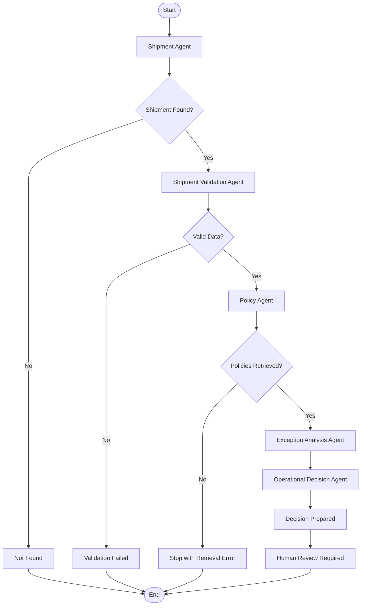

# Exercise 012 — Multi-Agent Freight Operations System

**AI Agent Training | Unit 2.2 — Agentic Frameworks**

**Project:** AI Agent Training — From Foundations to Logistics Applications  
**Exercise Status:** Completed — Validated Prototype  
**Development Environment:** Python 3.12.4, Visual Studio Code, Windows PowerShell

---

## 1. Objective

The objective of Exercise 012 was to design, implement, and test a multi-agent freight operations system capable of coordinating specialized logistics functions through a structured workflow.

Building on the previous exercises, this project introduces a modular architecture in which individual agents are responsible for specific operational tasks rather than assigning the entire process to a single language model.

The system was designed to:

- Retrieve shipment information from an existing local dataset.
- Validate shipment data before further processing.
- Retrieve relevant logistics policies using semantic search.
- Analyze shipment exceptions using structured operational rules.
- Prepare recommendations supported by shipment information and retrieved policies.
- Preserve a traceable history of agent execution.
- Prevent invalid shipments from advancing through the workflow.
- Require human review before operational actions are authorized.

The primary goal was not to achieve unrestricted agent autonomy, but to demonstrate reliable coordination, controlled execution, and practical decision support within the capabilities of the available development environment.

## 2. Technologies and Tools

The system was developed using the following technologies:

| Technology | Role |
|---|---|
| Python 3.12.4 | Core application development |
| LangGraph | Multi-agent workflow orchestration and conditional routing |
| LlamaIndex | Semantic retrieval of logistics policy documents |
| Hugging Face Embeddings | Vector representations for semantic similarity |
| JSON | Local shipment data storage |
| Python dictionaries and TypedDict | Shared workflow state |
| Visual Studio Code | Development and debugging |
| Windows PowerShell | Execution and testing |
| Git and GitHub | Version control and repository management |

The exercise reused existing logistics components from previous training activities rather than introducing unnecessary infrastructure or requiring additional large language models.

This approach supported modular development and reduced the risk of exceeding local hardware limitations.

## 3. System Architecture

The system consists of five specialized agents operating within a coordinated workflow.

### 3.1 Shipment Agent

The Shipment Agent is responsible for retrieving shipment records from the local dataset developed in Exercise 010.

Its responsibilities include:

- Accepting a shipment identifier.
- Searching for the corresponding shipment record.
- Returning the retrieved shipment information.
- Identifying nonexistent shipments.
- Recording its execution in the agent history.

A successful lookup allows the shipment to proceed to validation.

An unsuccessful lookup produces a `not_found` status and prevents unnecessary downstream processing.

### 3.2 Shipment Validation Agent

The Shipment Validation Agent verifies that the retrieved shipment contains the information required for operational assessment.

The validation process checks essential fields such as:

- Shipment status.
- Issue type.
- Priority.
- Description.
- Delivery confirmation.

If the required information is available, the agent returns a `validated` status.

If mandatory information is missing, the agent returns `validation_failed` and records the corresponding errors.

This validation stage prevents incomplete shipment records from reaching the policy retrieval and operational decision stages.

### 3.3 Policy Agent

The Policy Agent retrieves logistics procedures relevant to the shipment and its reported exception.

It integrates the semantic retrieval functionality developed in Exercise 009 using LlamaIndex and Hugging Face embeddings.

The retrieval process uses vector similarity to identify relevant policy documents.

Retrieved information includes:

- Policy filename.
- Similarity score.
- Relevant policy excerpt.

The local policy knowledge base contains documents addressing damaged shipments, delayed deliveries, and operational escalation procedures.

This agent provides supporting documentation for the subsequent analysis.

Importantly, a high similarity score indicates retrieval relevance, not automatic confirmation that a policy is applicable in every operational circumstance.

### 3.4 Exception Analysis Agent

The Exception Analysis Agent examines the validated shipment alongside the retrieved logistics policies.

Its purpose is to transform the available information into a structured operational assessment.

The analysis identifies:

- Shipment identifier.
- Exception type.
- Operational priority.
- Delivery confirmation status.
- Operational concern.
- Suggested action.
- Supporting policies.
- Human review requirement.

For the tested damaged-packaging scenario, the system identified potential shipment damage and recommended inspection, documentation, and operational review before release.

The analysis relies on structured business logic and retrieved policy information rather than treating generated language as an authoritative operational decision.

### 3.5 Operational Decision Agent

The Operational Decision Agent consolidates the shipment information, exception analysis, and supporting policy references into a structured recommendation.

Its output includes:

- Shipment identifier.
- Issue type.
- Priority.
- Recommended action.
- Supporting policies.
- Human review requirement.
- Approval status.
- Execution authorization status.

For the tested shipment, the recommendation was prepared successfully, while operational approval remained pending.

The system explicitly distinguished between preparing a recommendation and authorizing its execution.

The resulting decision required human review, with execution authorization set to `False`.

This separation is essential for responsible automation in logistics environments where operational decisions may affect customers, inventory, transportation, and delivery commitments.

## 4. Multi-Agent Workflow Orchestration

LangGraph was used to coordinate the agents through a shared workflow state and conditional execution paths.

### 4.1 Execution Sequence

The successful workflow follows this sequence:

1. Shipment Agent retrieves the shipment record.
2. Shipment Validation Agent verifies mandatory shipment information.
3. Policy Agent retrieves relevant logistics procedures.
4. Exception Analysis Agent evaluates the shipment exception.
5. Operational Decision Agent prepares a structured recommendation.
6. The workflow returns the final state and execution history.

### 4.2 Conditional Routing

Conditional routing prevents the system from proceeding when required information is unavailable.

The workflow supports early termination when:

- A shipment cannot be found.
- Shipment validation fails.
- A required processing stage cannot produce the information needed for subsequent analysis.

This design reduces unnecessary processing and prevents later agents from relying on invalid or incomplete input.

### 4.3 Workflow Diagram



The diagram represents the intended processing architecture. The automated integration tests specifically verified the successful route, the missing-shipment route, and isolated incomplete-shipment validation.

## 5. Shared State and Agent Communication

A central feature of the system is its shared state.

Rather than requiring agents to communicate through unrestricted natural-language conversations, each agent reads relevant information from a structured state and returns updates.

The shared state includes:

| State Field | Purpose |
|---|---|
| `shipment_id` | Identifies the shipment under investigation |
| `status` | Tracks workflow progress and outcomes |
| `errors` | Records processing and validation errors |
| `shipment` | Stores retrieved shipment information |
| `policies` | Stores retrieved logistics policy references |
| `exception_analysis` | Stores the structured exception assessment |
| `decision` | Stores the operational recommendation |
| `agent_history` | Records agent execution events |

This design provides a consistent interface between agents.

It also improves traceability by making it possible to inspect the workflow's progression and identify which processing stages were completed.

### 5.1 Agent Execution History

For the successfully tested shipment, the agent history recorded the following sequence:

```text
Shipment Agent: shipment retrieved
Shipment Validation: passed
Policy Agent: retrieved 3 policies
Exception Analysis Agent: analysis completed
Operational Decision Agent: recommendation prepared
```

This history confirms that the expected processing stages were reached in the intended order.

It should be understood as a lightweight execution trace, not as a complete production-grade audit logging system.

## 6. Test Scenarios and Results

The system was tested using shipment records and validation scenarios from the local development environment.

### 6.1 Scenario A — Valid Shipment

**Shipment ID:** `SHP-1045`

The test shipment belonged to Caribbean Retail Group and involved visible packaging damage.

The shipment was marked as high priority, with delivery confirmation set to `False`.

The system successfully:

1. Retrieved the shipment record.
2. Validated the required fields.
3. Retrieved three logistics policy references.
4. Generated a structured exception analysis.
5. Prepared an operational recommendation.

**Final status:** `decision_prepared`

The recommendation called for inspection, documentation of visible damage, and operational review before shipment release.

The decision retained human review as a requirement and did not authorize automatic execution.

**Result: PASS**

### 6.2 Scenario B — Nonexistent Shipment

**Shipment ID:** `SHP-9999`

The system attempted to retrieve a shipment identifier that did not exist in the local dataset.

The Shipment Agent returned:

```text
status: not_found
```

The workflow terminated without continuing to shipment validation, policy retrieval, exception analysis, or decision preparation.

This demonstrated that the system could avoid unnecessary processing when a required shipment record was unavailable.

**Result: PASS**

### 6.3 Scenario C — Incomplete Shipment Data

**Shipment ID:** `SHP-TEST`

A test shipment was created with intentionally incomplete information.

The record contained only a shipment identifier and a shipment status.

The Shipment Validation Agent detected missing required fields, including:

- `issue_type`
- `priority`
- `description`
- `delivery_confirmed`

The validation returned:

```text
status: validation_failed
```

The system also produced a list of missing-field errors.

This scenario verified the validation agent independently. It did not constitute an end-to-end LangGraph test of the incomplete-shipment route.

**Result: PASS**

## 7. Automated Integration Testing

After the individual agents and the complete workflow were implemented, an automated test script was created.

**Test file:** `exercises/exercise_012_tests.py`

The test suite verified:

1. Successful multi-agent execution for a valid shipment.
2. Early workflow termination for a nonexistent shipment.
3. Rejection of incomplete shipment information.
4. Expected agent execution history for the valid workflow.
5. Human review and execution authorization controls in the prepared decision.

The successful workflow test also confirmed that the returned state contained shipment information, retrieved policies, exception analysis, and a prepared decision.

### 7.1 Execution Command

```powershell
python exercises/exercise_012_tests.py
```

### 7.2 Verified Test Output

```text
EXERCISE 012 — AUTOMATED INTEGRATION TESTS
-------------------------------------------------------
PASS: Valid multi-agent workflow
PASS: Missing shipment workflow
PASS: Incomplete shipment validation
-------------------------------------------------------
ALL EXERCISE 012 TESTS PASSED
```

**Automated test result: 3/3 passed.**

All three tests completed successfully in the local environment.

These results establish that the tested workflow behaviors were functioning as expected at the time of execution.

They do not imply exhaustive test coverage or guarantee performance across all possible shipment scenarios.

## 8. Performance and Engineering Considerations

Exercise 012 was designed with practical performance constraints in mind.

Previous exercises demonstrated that small local language models may struggle with reliable tool calling, structured output generation, and multi-step reasoning.

Rather than depending on unrestricted model-generated decisions, this exercise prioritized structured processing, reusable components, explicit workflow states, and deterministic operational controls.

### 8.1 Strengths

**Modular architecture:** Each agent has a clearly defined responsibility, making the system easier to maintain and extend.

**Controlled execution:** LangGraph coordinates the processing sequence instead of relying on a language model to independently determine every next step.

**Semantic retrieval:** Relevant logistics policies can be retrieved using vector similarity.

**Traceability:** Agent history and structured outputs provide visibility into the processing sequence.

**Human oversight:** Recommendations remain subject to operational review.

**Reusable components:** Existing shipment retrieval, validation, and semantic search capabilities were incorporated into a larger system.

### 8.2 Observed Limitations

**Repeated embedding initialization:** During development and testing, repeated workflow executions displayed embedding-model loading messages. This indicates an opportunity to investigate and optimize resource initialization and reuse.

**Small policy knowledge base:** The retrieval system operates on a limited collection of local logistics documents. Results should not be interpreted as comprehensive policy coverage.

**Limited test dataset:** The validated scenarios represent a small subset of possible freight operations cases.

**Retrieval relevance:** Similarity scores help rank documents but do not independently establish policy correctness or operational applicability.

**Structured recommendations:** The system prepares operational recommendations but does not perform real-world shipment releases, carrier communications, or other external operational actions.

**Limited automated coverage:** The test suite verifies three important scenarios but does not exhaustively test every possible failure mode or malformed data condition.

### 8.3 Performance Philosophy

The project prioritizes reliability and practical usefulness over unrealistic expectations of perfect autonomous reasoning.

Performance should be evaluated according to the capabilities of the available models, hardware, data, and software components.

A successful system is one that produces useful, traceable, and appropriately controlled results within those constraints.

## 9. Relationship to Previous Exercises

Exercise 012 represents the integration of several capabilities developed throughout the training program.

| Previous Exercise | Contribution |
|---|---|
| Exercise 005 | Shipment exception management concepts |
| Exercise 006 | Logistics policy retrieval foundations |
| Exercise 007 | Policy-based decision support |
| Exercise 009 | Semantic search using LlamaIndex |
| Exercise 010 | Shipment lookup and tool-using retrieval integration |
| Exercise 011 | LangGraph workflow states and conditional routing |
| Exercise 012 | Multi-agent coordination across freight operations tasks |

Exercise 011 established the foundation for a reliable, state-driven logistics workflow.

Exercise 012 extended that approach by organizing the operational process into five specialized agents and integrating their responsibilities into a coordinated system.

This progression illustrates how smaller, independently developed capabilities can become components of a more sophisticated application.

## 10. Potential Future Improvements

Several improvements could increase the system's usefulness and maintainability:

1. **Embedding resource reuse:** Initialize retrieval resources once where practical, reducing repeated model-loading overhead.

2. **Expanded testing:** Add additional shipment types, validation failures, retrieval failures, and workflow interruption scenarios.

3. **Richer policy metadata:** Include policy identifiers, revision dates, applicability conditions, and document versions.

4. **Improved observability:** Introduce structured execution logs, timing measurements, and more detailed error tracking.

5. **Human approval workflow:** Develop an explicit review stage for accepting or rejecting prepared recommendations.

6. **Additional freight operations agents:** Explore specialized functions for carrier coordination, shipment tracking, document verification, and customer communication.

7. **External system integration:** Eventually connect the prototype to authorized logistics platforms, transportation management systems, or other operational data sources.

These improvements remain future development opportunities and are not presented as implemented functionality in Exercise 012.

## 11. Key Learning Outcomes

Exercise 012 provided practical experience in:

- Designing a multi-agent system around specialized operational responsibilities.
- Coordinating multiple agents using LangGraph.
- Managing communication through a shared state.
- Implementing conditional routing and early termination.
- Reusing semantic retrieval functionality from earlier exercises.
- Separating exception analysis from operational decision preparation.
- Preserving human oversight in automated decision support.
- Writing automated integration tests.
- Evaluating system behavior within local resource limitations.
- Documenting both successful results and unresolved engineering constraints.

The most important architectural lesson was that a multi-agent system does not require every agent to operate as an independent large language model.

Specialized software components can be organized as agents when they perform distinct responsibilities within a coordinated workflow.

This approach can offer greater predictability and control for operational applications.

## 12. Conclusion

Exercise 012 successfully implemented and validated a prototype multi-agent freight operations system.

The application coordinated five specialized agents to retrieve shipment information, validate operational data, retrieve relevant logistics policies, analyze shipment exceptions, and prepare structured recommendations.

LangGraph provided the orchestration mechanism, while LlamaIndex supported semantic policy retrieval.

The automated test suite confirmed three important behaviors: successful execution for a valid shipment, early termination for a nonexistent shipment, and rejection of incomplete shipment data.

All three tests passed.

The resulting architecture demonstrated the value of combining specialized agents, structured state management, semantic retrieval, and human oversight.

Although the system remains a local training prototype with limited datasets and testing coverage, it establishes a foundation for developing more advanced AI-assisted freight forwarding and third-party logistics applications.

**Final Outcome: Completed and validated multi-agent freight operations prototype, with 3/3 automated integration tests passed.**